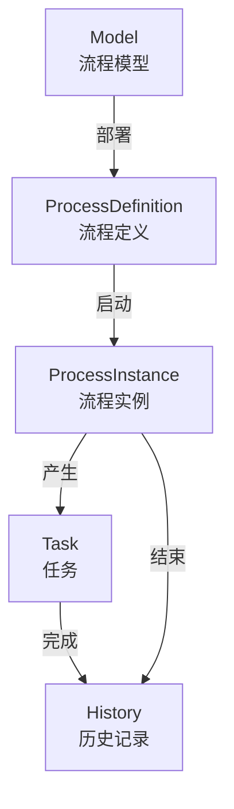

---
tags:
  - backend
  - workflow
---

# 工作流

> 基于 Flowable 流程引擎的工作流管理模块。路径：`spectra-workflow`。本页按 Controller、Service、流程定义、任务动作和 OA 回调记录当前能力，源码、流程定义和 SQL 是实现事实来源。

Workflow 是可选业务模块，由 `spectra-launch` 根据 `spectra.modules.workflow.enabled` 在启动期装配，并通过 `workflow.api` 向 OA 提供稳定端口。Flowable 的 `tenant_id_` 等引擎字段仅用于兼容 Flowable schema，不构成应用租户能力；应用层不实现租户上下文或租户隔离。

流程定义列表 `/workflow/process-definitions` 的共享认证与权限边界：合成 Root 授权有效时两个独立应用 JVM 均返回 200，角色自然到期后两端 403，凭据自然到期后旧 Access 两端 401；仍有效的 Root 保持 200。两步真实 Flowable 实例验证了结果通知收件人为首办理人、下一待办收件人为第二办理人，错误办理人提交被拒绝且无通知，已完成任务重放被拒绝且无重复请求，两个线程竞争完成末任务仅一次成功。任务 HTTP 入口匿名和角色自然到期时以 401/403 拒绝且任务不变，恢复授权后同一令牌完成任务成功。

流程启动和任务推进共用 `WorkflowTaskTodoNotifier`：有明确办理人且解析到活跃用户的当前任务，以 `workflow:todo:<taskId>` 为幂等键写入站内待办；无办理人或无法解析活跃用户时跳过通知。启动先在 PostgreSQL 当前事务内按业务键加 advisory lock，再查重、启动并写入首任务通知。相同业务键重复启动被拒绝且待办通知仍为一条；通知目录或入队异常时启动抛出 `DataSaveException` 并回滚业务流程，恢复渠道后同一业务键可成功启动且首待办恰一条。办理人为空或未映射活跃用户时流程仍可启动，任务通知为零。两个独立应用 JVM 经屏障同时启动相同业务键时仅一个成功，运行实例、首任务和待办请求各一条。

## 核心概念

## Controller

| Controller | 路径 | 说明 |
|---|---|---|
| `ProcessDefinitionController` | `/workflow/process-definitions/**` | 流程定义管理（查询/挂起/激活/获取资源/部署） |
| `ProcessInstanceController` | `/workflow/process-instances/**` | 流程实例管理（启动/查询/终止） |
| `TaskController` | `/workflow/tasks/**` | 任务管理（待办/已办/审批/驳回/转办/委派） |

当前 `1.0.0` 不提供独立的流程模型草稿、运行时跳转/加签或历史查询 Controller。流程设计器导出的 BPMN XML 直接通过 `ProcessDefinitionController` 部署；流程实例状态、变量、图形和任务轨迹只通过已发布的流程实例与任务接口访问。

## Service

| Service | 实现类 | 说明 |
|---|---|---|
| `com.devops00.spectra.workflow.api.WorkflowService` | `WorkflowServiceImpl` | 流程核心操作（部署/启动/挂起）；OA 只依赖该公共 API |
| `com.devops00.spectra.workflow.api.ProcessInstanceService` | `ProcessInstanceServiceImpl` | 流程实例管理；OA 只依赖该公共 API |
| `com.devops00.spectra.workflow.api.TaskService` | `TaskServiceImpl` | 待办、已办和任务动作；OA 只依赖该公共 API |

## OA 业务回调

业务流程启动时将 `businessKey` 统一设置为通用申请主表 `oa_application.id`。`workflow.api.WorkflowService` 维护“流程定义 KEY → `workflow.api.ApprovalCallback`”注册表；任务完成且 Flowable 流程进入历史结束态后，`TaskServiceImpl` 分发 `onApproved` / `onRejected`，终止流程时由 `ProcessInstanceServiceImpl` 分发 `onTerminated`。`workflow.api` 是模块对 OA 暴露的公共端口，Flowable 和 Workflow Service 实现细节仍留在 `spectra-workflow`。

回调实现必须按业务状态做幂等保护。当前请假流程注册 KEY 为 `oa_leave_approval`：通过回写 `oa_attendance_record`，驳回/撤回/取消释放预占额度，并向申请人写入 OA 消息。费用报销流程注册 KEY 为 `oa_reimbursement_approval`：审批回写申请状态，付款状态独立保持 `PENDING`，登记付款后转为 `PAID`。采购流程注册 KEY 为 `oa_purchase_approval`：审批回写申请状态，审批通过后进入 `NOT_STARTED` 执行状态，执行登记转为 `ORDERED`，收货按批次累计数量并转为 `PARTIAL_RECEIVED` 或 `RECEIVED`。报销驳回由真实 Flowable 任务驱动 OA 申请状态转为 `REJECTED`，原因与提交内容一致，申请人收到一条 OA 通知；重复驳回被拒绝且通知仍为一条。请假、采购、报销的通过、驳回和终止回调都按明确申请人 ID 投递，重放不重复入队。

任务查询 VO 返回 `processDefinitionKey`、`businessKey`，供 Web 审批中心定位 OA 业务详情。Task Service 将待办/已办、审批、驳回、转办和委派传入的用户名绑定当前认证主体；四个写操作在查询 Flowable 任务前读取当前有效授权快照，要求 `workflow:task:update`，再校验任务办理人所有权。Service 直接调用时，无身份、参数冒用、缺权限或授权快照读取失败均在任务查询与写入前被拒绝；角色自然到期后拒绝。正式 HTTP 入口匿名和角色自然到期时四个写动作及待办以 401/403 拒绝且任务不变；恢复授权后完成任务成功。转办后 Flowable 办理人为目标用户，委派后办理人为目标且委派状态为 `PENDING`，驳回后任务和流程实例结束。OA 工作台仍按当前本人统计待办，OA 详情的流程参与判断仅按当前本人查询。OA 详情可见范围同时包含申请人、同部门用户、当前办理人和历史办理人。

流程终止采用幂等语义：业务撤回已经终止实例后，再执行业务取消只记录“实例已结束”并继续完成状态迁移，不因重复终止返回 404。当前自动部署并由 OA 使用的流程 KEY 仅为 `oa_leave_approval`、`oa_reimbursement_approval`、`oa_purchase_approval`；其他流程定义不参与 OA 自动部署。

Web 审批中心直接复用 `/workflow/tasks/todo`、`/workflow/tasks/done` 和任务动作端点，不另建 OA 审批任务表。待办/已办支持可选查询参数 `process_definition_key`，用于审批中心按请假、报销或采购流程类型筛选；省略参数时返回当前用户全部任务。

任务完成、驳回、转办、委派四个写入口在业务事务中先经 `AuthorizationMutationFence` 锁操作者 `sys_user` 行，再读取当前有效授权并执行 Flowable 写入；无事务、用户不存在、用户非 `ACTIVE` 或数据库锁失败均拒绝或传播失败。角色或 Assignment 缩权先提交时，任务动作等待后拒绝；任务动作先提交时，授权变更等待其完成。数据库锁与授权读取故障直接拒绝并回滚任务、OA 回调和通知，不使用登录时旧快照继续写入。请假、采购、报销回调的通知都按明确申请人 ID 投递，终止不发送状态通知；重放不重复入队。

## 配置

| 配置类 | 说明 |
|---|---|
| `WorkflowConfiguration` | Flowable 引擎配置（数据源/自动部署/字体等） |

## 关键文件路径

| 文件 | 路径 |
|---|---|
| ProcessDefinitionController | `spectra-modules/spectra-workflow/src/main/java/com/devops00/spectra/workflow/controller/ProcessDefinitionController.java` |
| ProcessInstanceController | `spectra-modules/spectra-workflow/src/main/java/com/devops00/spectra/workflow/controller/ProcessInstanceController.java` |
| Workflow API | `spectra-modules/spectra-workflow/src/main/java/com/devops00/spectra/workflow/api/` |
| DeployProcessFrom | `spectra-modules/spectra-workflow/src/main/java/com/devops00/spectra/workflow/javabean/from/DeployProcessFrom.java` |
| ProcessDefinitionResourceVO | `spectra-modules/spectra-workflow/src/main/java/com/devops00/spectra/workflow/javabean/vo/ProcessDefinitionResourceVO.java` |
| WorkflowConfiguration | `spectra-modules/spectra-workflow/src/main/java/com/devops00/spectra/workflow/configure/WorkflowConfiguration.java` |
| TaskController | `spectra-modules/spectra-workflow/src/main/java/com/devops00/spectra/workflow/controller/TaskController.java` |
| WorkflowServiceImpl | `spectra-modules/spectra-workflow/src/main/java/com/devops00/spectra/workflow/service/impl/WorkflowServiceImpl.java` |

## 相关笔记

- [[00-架构分层]]
- [[16-API总览]]
